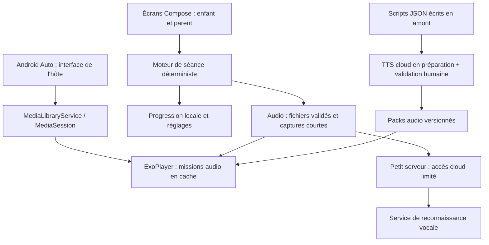

# Hello Quest — apprendre l’anglais à voix haute

Dossier de conception · 21 octobre 2026 · nom de travail

> **État du PoC livré, version 0.18.** L’application Android native est dans [`android/`](android/), avec les instructions de build dans le [README](README.md) et des [captures prises sur Pixel 7](docs/screenshots/). L’APK local est exclu de Git en raison de sa taille. Le catalogue couvre six univers et 41 sujets, soit 246 couples sujet–univers, 2 694 exercices, 1 727 cartes de cours, 18 lectures guidées et 12 mini-dialogues. Une leçon terminée rend ses exercices et son quiz accessibles ; le quiz réussi à plus de 75 % valide le sujet dans l’univers choisi. Les cours et exercices sont illustrés par des photographies créditées. Android Auto utilise des pistes audio préparées en amont. Les sections ci-dessous conservent aussi l’historique de conception du PoC et peuvent décrire des pistes non implémentées.

## 1. Proposition et décisions déjà prises

Créer un compagnon d’aventures audio pour un enfant francophone de CE2. Il écoute, répond, répète et aide un personnage à terminer une courte mission. Le parent choisit un sujet, un univers et la durée avant le départ.

**Première étape recommandée : un prototype Android avec trois missions et un essai familial de deux semaines.** L’objectif est de mesurer l’envie de recommencer et la qualité des échanges avant de construire un catalogue complet.

Les préférences confirmées sont :

- Usage autonome sur téléphone/tablette **et** séance partagée sur les haut-parleurs de la voiture.
- Connexion Internet acceptable pour obtenir une meilleure qualité.
- Prototype pour tester l’intérêt de l’enfant avant un investissement plus important.
- Téléphone disponible pour les essais : **Pixel 7**.
- Univers du PoC : **Star Wars**, **Harry Potter**, **Échecs**, **Jeux vidéo**, **Voyages et pays** et **Animaux**. Les trois derniers ont été ajoutés après les premiers essais.
- **Dialogues et pistes TTS préparés en amont**, y compris questions, indices, corrections et variantes lentes.
- **Intégration Android Auto standard, indépendante d’un modèle de voiture** : aucune configuration constructeur ni demande de modèle nécessaire au cadrage.

Hypothèses provisoires : débutant, consignes en français, accent britannique par défaut, séances de 5 à 8 minutes. L’anglais américain est proposé à l’écoute comparative. Ces choix sont révisables ; ni le niveau actuel, ni la durée des trajets, ni la version Android installée ne sont connus. La conception cible le contrat Android Auto ; les essais matériels ultérieurs vérifieront l’intégration sans conditionner l’architecture à un véhicule.

## 2. Faisabilité Android Auto : le choix qui structure le projet

Android Auto projette une expérience depuis le téléphone ; Android Automotive OS est installé dans le véhicule. Ce projet cible **Android sur téléphone + Android Auto**, sans développer une application Automotive séparée à ce stade.

Google autorise des catégories précises. Les applications audio peuvent fonctionner en roulant ; les jeux sont réservés au stationnement. Il n’existe pas de catégorie générale « professeur conversationnel / quiz éducatif en roulant ». **Un lecteur de missions audio constitue donc une piste crédible ; son acceptation ne peut pas être garantie avant vérification des exigences et revue Google.** Déduction de conception à partir des [catégories Android for Cars](https://developer.android.com/training/cars).

| Usage | Expérience proposée | Statut |
|---|---|---|
| Téléphone, maison ou enfant passager | Conversation guidée, microphone ouvert après chaque question, correction contextualisée | Cible du prototype |
| Android Auto en roulant | Catalogue court de missions, lecture/pause, précédent/suivant ; questions et silences inclus dans l’audio | Intégration média à prototyper |
| Réponse de l’enfant pendant la lecture Auto | Il répond à voix haute ; l’audio donne ensuite le modèle attendu | Fonctionne pédagogiquement sans analyse automatique |
| Capture et correction via le microphone de la voiture | Interaction conversationnelle avec réponse réellement analysée | Recherche conditionnelle, hors promesse initiale |
| Jeu visuel sur l’écran central à l’arrêt | Éventuelle extension | Sans intérêt prioritaire pour ce besoin |

L’application expose son catalogue, ses métadonnées et ses commandes de lecture à Android Auto via les interfaces média standard. L’hôte Android Auto rend l’interface et assure l’intégration avec les contrôles du véhicule. Notre lecteur gère la séance, la lecture et les événements de focus audio. Aucune branche de code par marque ou modèle n’est prévue ; la maquette automobile est indicative. [Architecture média automobile](https://developer.android.com/training/cars/media), [critères de qualité](https://developer.android.com/docs/quality-guidelines/car-app-quality).

**Ce que cela change pour l’utilisateur :** le prototype peut faire parler l’enfant en voiture dès la première version, mais l’édition Auto initiale ne saura pas dire si sa réponse était juste. Elle mémorisera une mission écoutée, pas une compétence acquise.

L’API `CarAudioRecord` existe pour les applications de la Car App Library ; elle requiert un `CarContext` et une gestion du focus audio. Sa présence ne garantit ni l’accès depuis une application média classique, ni l’éligibilité de notre usage. Les modèles média Car App Library sont encore présentés comme un programme d’accès anticipé à la date de consultation. Ce point doit être résolu avant toute extension conversationnelle Auto. [API CarAudioRecord](https://developer.android.com/reference/androidx/car/app/media/CarAudioRecord), [catégories et publication](https://developer.android.com/training/cars).

## 3. Expérience pédagogique

### Une mission plutôt qu’une leçon de grammaire

Exemple : « Luke et Leia préparent une mission. Aide R2-D2 à présenter l’équipage. » La compétence est l’emploi de *I / you / he / she* ; l’enfant voit une aventure et des phrases utilisables. Les termes « pronoms personnels » et « verbes » restent accessibles dans les réglages du parent. Pip reste la mascotte de l’application et accompagne la découverte des univers choisis.

Pour le CE2 en 2026-2027, le programme de cycle 2 antérieur reste applicable ; le nouveau programme de langues entre en vigueur au CE2 en 2027-2028. Les contenus seront associés à une version du référentiel, avec une progression vers les bases de l’oral A1 et sans prétendre certifier ce niveau. [Calendrier et ressources Éduscol](https://eduscol.education.gouv.fr/7058/ressources-d-accompagnement-pour-les-langues-vivantes-etrangeres-et-regionales-l-ecole-elementaire).

| Compétence sélectionnable | Premiers objectifs | Exemple de production |
|---|---|---|
| Se présenter | Bonjour, prénom, âge, état simple | “Hello! I am eight.” |
| Pronoms personnels | I, you, he, she ; puis it, we, they | “She is a pilot.” |
| Verbes et actions | be, have, like, can ; go, see, jump, open | “I can jump.” |
| Vocabulaire | Nombres 1–10 puis 20, couleurs, animaux, objets, famille | “A blue star.” |
| Compréhension orale | Une consigne, une information, puis deux phrases | “The robot has a red bag.” |
| Petits dialogues | Réponse courte, demande, préférence | “Do you like cats?” — “Yes, I do.” |

La compréhension orale est aussi une **modalité transversale**, pas seulement une catégorie de contenu. Modéliser séparément la compétence, le type d’exercice et l’univers permettra de travailler, par exemple, les pronoms en compréhension puis en production.

Les séances suivent le même rythme :

1. **Accueil et rappel — environ 1 min.** Réutiliser une expression connue.
2. **Découverte — 1 à 2 min.** Deux ou trois expressions nouvelles avec modèle sonore.
3. **Mission — 2 à 4 min.** Écouter, choisir oralement, compléter puis produire.
4. **Transfert — 1 min.** Employer l’expression hors de l’univers fictif.
5. **Fin — 20 s.** Nommer ce qui a été pratiqué et proposer de revenir plus tard.

Ces durées sont des hypothèses à ajuster. La séance peut s’arrêter à la fin de chaque petit bloc. Le rythme de référence est 5 ou 8 minutes ; une option 12 minutes ajoute de la révision après validation de l’intérêt.

### Encourager sans fabriquer une réussite

- Bonne réponse reconnue : validation courte et réemploi de la phrase.
- Réponse incorrecte reconnue : modèle correct, indice puis un nouvel essai au maximum.
- Son ambigu, silence ou bruit : « Je n’ai pas bien entendu. On essaie encore ? » Aucun échec pédagogique enregistré.
- Deux captures inutilisables : proposer une séance d’écoute et continuer sans exiger l’intervention du conducteur.
- En mode audio sans microphone : « Voici une réponse possible… », jamais « Bravo, tu as bien répondu ».
- Objectif de prononciation : intelligibilité et envie de parler. Un mot transcrit correctement ne prouve pas une bonne prononciation.

Les révisions espacées et le rappel actif sont de bons principes de départ. Une règle simple pourra proposer une reprise à J+1, J+3, J+7 et J+14, **intervalles de conception à tester**, et non recette universelle. Séparer les indicateurs « écouté », « répété », « reconnu sans aide » et « retrouvé plus tard ». [Guide IES sur l’apprentissage et la mémorisation](https://ies.ed.gov/ncee/wwc/Docs/PracticeGuide/20072004.pdf).

### Les univers

| Passion | Univers proposé pour la première version | Exemples et précautions pédagogiques |
|---|---|---|
| Star Wars | **Star Wars** : Luke, Leia, R2-D2 et les Jedi | “I am a pilot.” Les personnages donnent le contexte ; les premières réponses attendues restent des expressions courantes. |
| Harry Potter | **Harry Potter** : Poudlard, Harry, Hermione et Hedwige | “The owl is white.” Les répliques pédagogiques sont écrites pour le PoC, avec une syntaxe naturelle. |
| Échecs | **Royaume des échecs** : roi, reine, cavalier | “The king is happy.” Puis couleurs, positions et actions ; pas de visualisation obligatoire d’un échiquier en voiture. |
| Jeux vidéo | **Jeux vidéo** : Nova et le robot Pixel | “I can jump.” Des personnages originaux et des objets de jeu simples. |
| Voyages et pays | **Voyages et pays** : Mia et Léo | “We are in Spain.” Pays, déplacement et annonces courtes. |
| Animaux | **Animaux** : Luna et le refuge | “The bird can fly.” Noms, actions et descriptions faciles à reconnaître. |

**Décision du PoC : conserver les vrais univers Star Wars et Harry Potter dans les choix, les titres et les dialogues.** Les six scripts sont préparés dans [dialogues-poc.md](content/dialogues-poc.md), à partir du [catalogue JSON](content/dialogues-poc.json). Les éventuelles questions de diffusion seront traitées si le projet évolue vers une publication.

## 4. Le vocal et les accents

### Recommandation

Utiliser une voix française pour guider et une voix anglaise de locale explicite `en-GB` ou `en-US` pour les modèles. Garder le même accent dans une mission et introduire progressivement l’autre accent en compréhension. La qualité doit être jugée à l’écoute, avec l’enfant : naturel, consonnes distinctes, débit, intonation, fatigue après plusieurs minutes.

| Solution à écouter | Apport potentiel | Compromis |
|---|---|---|
| **Google Cloud TTS, Chirp 3 HD** | Voix disponibles en anglais britannique, américain et français ; candidat de départ | Valider chaque voix et les contrôles réellement disponibles ; certaines fonctions SSML/rythme sont en préversion. |
| **Azure Speech, voix neuronales** | Large catalogue de langues/voix ; possibilité d’évaluer séparément la prononciation plus tard | Une seconde intégration n’est justifiée que si l’essai apporte un gain audible. |
| **ElevenLabs** | Candidat pour une narration expressive | Comparer les voix précises, la constance de l’accent, les conditions de stockage et le coût du plan. |
| **TTS Android installé** | Secours éventuel et démonstration rapide | Qualité et voix variables selon appareil/moteur ; insuffisant comme promesse de qualité premium. |

Sources : [Chirp 3 HD](https://docs.cloud.google.com/text-to-speech/docs/chirp3-hd), [voix Azure](https://learn.microsoft.com/en-us/azure/ai-services/speech-service/language-support?tabs=tts), [modèles ElevenLabs](https://elevenlabs.io/docs/overview/models).

**Piste initiale, antérieure au PoC : comparer Google et Azure sur les mêmes 12 phrases ; ajouter ElevenLabs seulement si la narration le justifie.** Le prototype livré emploie déjà les trois voix précisées en tête de dossier. Les sélecteurs d’accent de la maquette illustrent un réglage ; son audio éventuel utilise seulement les voix du navigateur et ne représente pas les fichiers embarqués dans l’APK.

**Décision d’architecture réalisée : toutes les répliques du PoC sont écrites en amont et leurs pistes TTS sont produites avant la séance.** Cela inclut les cours, la narration, les questions, les modèles, les indices, les corrections, les messages de silence/bruit et les conclusions. Le catalogue et ses 5 207 variantes de clips référencées, plus 492 pistes Android Auto, sont embarqués dans l’APK.

Chaîne de préparation : **script JSON → relecture → synthèse TTS par langue/accent et débit → écoute de contrôle → pack versionné**. Conserver les segments déjà validés ; régénérer seulement ceux dont le texte, la voix ou le débit change. La clé d’un fichier audio inclura ces paramètres pour éviter une réutilisation incorrecte.

Pendant la séance, le moteur sélectionne et lit les fichiers du pack. La reconnaissance éventuelle reste dynamique, mais les réponses de l’application sont des branches préparées. Aucun appel LLM ni TTS n’est nécessaire dans cette boucle. Préparer deux sorties à partir des mêmes textes : les clips courts pour le téléphone et des chapitres assemblés avec des silences pour Android Auto. Une fois les packs disponibles, seule la reconnaissance cloud nécessite le réseau ; le mode écoute continue sans analyse si la connexion tombe.

Séparer les segments français et anglais, identifier la voix et la version dans chaque fichier, normaliser le volume, garder les effets sonores en dehors des phrases. Pour « plus lentement », préparer une version lente intelligible ; tester les contrôles du fournisseur plutôt que supposer qu’un même SSML fonctionnera partout.

### Reconnaissance de l’enfant

La première intégration à comparer est un service STT cloud sur des réponses courtes et attendues. Ne pas envoyer tout le trajet : ouvrir une fenêtre après le signal sonore, fermer à la fin de la parole ou après un délai, puis produire le retour. Le serveur reçoit uniquement l’extrait utile et l’identifiant du contexte attendu.

Sur Pixel 7, tester aussi la reconnaissance locale Android si elle est disponible dans la langue souhaitée. L’API permet de vérifier sa disponibilité ; le service Android par défaut peut envoyer l’audio à distance et n’est pas conçu pour l’écoute permanente. Le modèle exact et sa disponibilité doivent être observés sur le téléphone, pas déduits du seul modèle Pixel. [SpeechRecognizer](https://developer.android.com/reference/android/speech/SpeechRecognizer).

Dans la première version, pas de note de prononciation sur 100. Une évaluation spécialisée reste une option ultérieure : les conditions acoustiques et l’âge influencent le résultat. Microsoft demande notamment d’adapter l’interprétation des scores au contexte et aux enfants. [Limites de Pronunciation Assessment](https://learn.microsoft.com/en-us/azure/foundry/responsible-ai/speech-service/pronunciation-assessment/characteristics-and-limitations-pronunciation-assessment).

Commandes visées sur téléphone : « répète », « plus lentement », « indice », « passe », « pause ». Elles sont reconnues **pendant les fenêtres d’écoute** ; une commande permanente pendant que l’application parle nécessiterait un travail supplémentaire. Une fois en pause, reprise par contrôle média, bouton du téléphone accessible au passager ou commande système compatible. Les commandes françaises et les réponses anglaises doivent être testées ensemble ; le changement de langue ne doit pas être supposé automatique.

## 5. Les maquettes livrées

Ouvrir [maquettes/index.html](maquettes/index.html) dans un navigateur. Aucun compte ni installation n’est nécessaire. La maquette est autonome et ne demande pas l’accès au microphone.

1. **Accueil enfant** : reprendre une mission, découvrir l’univers et commencer.
2. **Préparer** : sélectionner univers, une ou plusieurs compétences, durée et accent ; sauvegarde dans la session de démonstration.
3. **Conversation** : question, fenêtre d’écoute simulée, réponse reconnue, indice ou problème de son ; progression jusqu’à la fin.
4. **Voiture** : aperçu indicatif du lecteur média Android Auto, sans boutons de réponses et sans résultats d’évaluation.
5. **Parents** : progrès illustratifs, réglages vocaux et explication du traitement audio.

Direction visuelle : fond crème, indigo profond, accents menthe, grandes zones tactiles, personnage original. Aucun texte à lire pour réussir une séance audio. Les informations techniques et les contrôles de simulation restent en dehors de l’écran destiné à l’enfant.

La maquette permet de comparer les parcours et les formulations. Elle ne valide ni la qualité du microphone, ni la reconnaissance, ni le comportement Android Auto réel.

## 6. Architecture minimale recommandée

**Android natif : Kotlin + Jetpack Compose + Media3.** Les contraintes centrales concernent les services audio, le microphone et Android Auto ; une interface multiplateforme introduirait ici des ponts natifs sans bénéfice demandé. Commencer par un seul module Android organisé en packages, avec un petit serveur uniquement pour les appels cloud utilisés à l’exécution.



`MediaLibraryService` expose les missions au navigateur média automobile ; `MediaSession` fournit les contrôles et ExoPlayer lit les fichiers. La lecture doit vivre dans un service, indépendamment de l’écran Compose. [Catalogue Media3](https://developer.android.com/media/media3/session/serve-content), [lecture en arrière-plan](https://developer.android.com/media/media3/session/background-playback).

Structure **proposée pour le futur code**, non encore implémentée :

```text
hello-quest/
  android/app/src/main/java/.../
    ui/                 # accueil, préparation, séance, parent
    learning/           # état de séance, réponses, révisions
    audio/              # lecteur, capture, focus, service média
    data/               # Room, DataStore, catalogue et téléchargements
  content/
    skills/             # objectifs, prérequis, réponses acceptables
    universes/          # personnages et variations éditoriales
    missions/           # scripts JSON validés et variantes audio
  tools/content/        # production des packs avant la séance
  server/               # un endpoint STT, si nécessaire pour le prototype
  docs/                 # décisions, scénarios d’essai, sources
```

Room peut stocker les tentatives et DataStore les préférences. Pour six missions, les scripts et sons peuvent être embarqués ; pas besoin de CMS, de compte familial, de synchronisation ou de plateforme de génération de contenus.

Le serveur conserve la clé fournisseur, limite la durée et la taille des extraits, applique un quota et ne journalise pas l’audio. Une clé secrète de service ne doit pas être intégrée dans l’APK. La protection et la politique de conservation du fournisseur seront vérifiées avant le premier essai avec l’enfant.

### États et interruptions

```text
PRÊT → LECTURE_QUESTION → ÉCOUTE → INTERPRÉTATION → RETOUR → ÉTAPE_SUIVANTE
                         ↓             ↓
                    SILENCE/BRUIT    HORS_RÉSEAU
                         └────→ AIDE ou ÉCOUTE_SANS_ANALYSE

Tout état → PAUSE/APPEL → REPRISE au début de la question en cours
Toute séance → FIN → mémorisation du type de participation réellement observé
```

Préférer d’abord une alternance stricte : l’application parle, puis elle écoute. Cela évite de traiter sa propre voix comme une réponse et facilite les essais dans le bruit. Une interruption vocale pendant la narration pourra venir ensuite si elle apporte une valeur démontrée.

Pour une séance vocale avec écran éteint, évaluer un service au premier plan de type microphone démarré depuis l’application visible, avec les permissions et notifications requises. Le système restreint son démarrage en arrière-plan. Les appels et annonces de navigation doivent interrompre proprement l’activité audio ; ne jamais compter une réponse pendant une interruption. [Services microphone](https://developer.android.com/develop/background-work/services/fgs/service-types), [focus audio](https://developer.android.com/media/optimize/audio-focus).

### Modèle de contenu

Modèle actuel : `Topic` identifie un sujet d’apprentissage ; `Universe` définit la forme narrative ; `Lesson` est le couple unique `universeId:topicId` et contient cours et exercices. Les dialogues et lectures portent `topicId` dans leur univers. Les pistes Android Auto suivent le même couple. La mémoire des questions et notions est stable entre univers, tandis que les leçons terminées sont aussi comptées par couple. « Tous les thèmes » est un entraînement mélange séparé. Les futures tentatives pourront distinguer plus finement résultat linguistique et résultat technique.

Le [catalogue de dialogues](content/dialogues-poc.json) est la source des six univers et des 246 leçons. Le fichier [exemple-mission.json](exemple-mission.json) illustre historiquement des branches de feedback et l’assemblage audio Auto ; les fichiers audio effectifs sont embarqués dans l’application.

La génération assistée intervient lors de la préparation éditoriale. Le moteur de séance suit des scripts déterministes : les corrections sont vérifiables, les extraits réutilisables et le délai de retour ne dépend pas de la génération d’un nouveau dialogue.

## 7. Plan de réalisation et critères de passage

Estimations de travail actif pour un développeur Android expérimenté, hors délais de validation Google et temps de retour familial. Elles ne sont pas un engagement de calendrier.

| Étape | Charge indicative | Livrable | Vérification avant de continuer |
|---|---:|---|---|
| 0 — Essai audio et faisabilité | 2–3 jours | 12 phrases comparables, une mission audio de 5 min, squelette média Auto, essai de capture sur Pixel | L’enfant comprend la voix ; le média apparaît dans le DHU ; routes audio et micro observées |
| 1 — Prototype vertical | 5–8 jours | Une mission complète sur téléphone, réponses courtes, aide, pause/reprise, variante lecteur Auto | Au moins 80 % des réponses courtes utilisables sur 30 essais dans la configuration retenue, erreurs techniques sans pénalité |
| 2 — Trois univers et essai familial | 3–5 jours + 2 semaines d’usage | Trois missions de 5–8 min, une par univers ; choix des blocs pronoms/actions/vocabulaire-compréhension | Sur 6 séances : au moins 4 terminées volontairement et envie de recommencer à plusieurs reprises |
| 3 — Petit MVP, seulement si l’essai convainc | 10–15 jours | 12 missions, progression, révisions, téléchargements, espace parent consolidé | Réemploi d’expressions après plusieurs jours ; stabilité audio ; charge éditoriale acceptable |
| 4 — Diffusion éventuelle | À estimer séparément | Packaging, tests supplémentaires, politiques famille et revue automobile | Public cible, droits, modalités de traitement et distribution fixés |

**Ordre de grandeur du prototype : 10 à 16 jours de travail**, puis observation familiale. La préparation des trois packs audio fait partie de ce périmètre. L’intégration cible Android Auto standard ; aucun modèle de véhicule n’est un prérequis. La capture via le microphone voiture reste une branche expérimentale distincte du lecteur média.

Les six missions contiennent des blocs comparables : se présenter, identifier une couleur/un objet, employer une action simple. Réutiliser les objectifs tout en adaptant les situations. Les six familles de compétences sont prévues dans le modèle ; le prototype n’a pas besoin de remplir toutes les combinaisons thème × univers × accent × difficulté.

### Backlog priorisé

**P0, pour décider si le projet mérite la suite :** lecteur de mission, une voix anglaise retenue après écoute, consignes françaises, fenêtre d’écoute sur téléphone, retour tolérant, pause et reprise, deux univers supplémentaires courts, version audio Auto et journal local minimal des résultats.

**P1, après retour positif :** filtre fin des compétences, révisions espacées, contraste et accessibilité consolidés, anglais américain, suivi parent, packs téléchargeables et reprise après arrêt du processus.

**P2, selon les usages :** analyse de prononciation, extension du catalogue pré-généré, multi-profils, synchronisation, diffusion publique, interaction via micro voiture si les conditions techniques et de plateforme le permettent.

## 8. Validation en situation réelle

### Qualité pédagogique

- Observer s’il répond sans regarder l’écran et s’il comprend la consigne en une écoute.
- Demander une expression nouvelle dans un autre contexte le lendemain et quelques jours plus tard.
- Observer l’intérêt pour chaque univers sans transformer le pilote en examen.
- Distinguer intérêt pour l’histoire, plaisir de parler et mémorisation ; six séances ne prouvent pas une efficacité pédagogique générale.

### Audio et téléphone

- Tester 30 réponses courtes annotées par un adulte : justes, fausses, hésitantes et ambiguës. Mesurer séparément les faux rejets et les faux succès.
- Fixer comme cible provisoire moins de 2 s de délai médian après la fin de parole, moins de 4 s au 95e percentile ; déclencher une explication puis le mode écoute si le délai devient excessif.
- Tester Pixel 7 au calme, puis enfant passager avec appareil proche de lui, puis installation partagée avec le téléphone à l’avant.
- Vérifier silence, radio, climatisation, voix du parent, micro refusé, mode avion, perte de réseau au milieu d’une réponse, verrouillage, appel, navigation et déconnexion de la voiture.
- Tester le français des commandes et l’anglais des réponses, y compris les contractions et les variantes britanniques/américaines prévues.

### Android Auto

Le DHU sert de référence pour vérifier le catalogue, les métadonnées, la lecture, les commandes et plusieurs formats d’écran. Les essais d’intégration ultérieurs sur des hôtes Android Auto disponibles portent sur le même contrat, sans ajouter de configuration par constructeur. L’application doit être préparée à l’arrêt ; les essais matériels ne bloquent pas le cadrage sur un véhicule précis. [Tests et critères Android Auto](https://developer.android.com/docs/quality-guidelines/car-app-quality).

Android Auto ne dispense pas l’application de vérifier l’API et les permissions nécessaires à une capture vocale. La lecture média et l’accès au microphone sont deux capacités distinctes. Cette vérification reste générique à la plateforme ; aucune connaissance de la marque ou du modèle de voiture n’est demandée pour poursuivre.

## 9. Coûts et traitement des données

### Budget technique de départ

Les tarifs consultés le 18 octobre 2026 donnent un ordre de grandeur, en dollars américains et hors taxes. Ils ne couvrent pas le développement ni la validation des contenus.

| Poste | Hypothèse illustrative | Calcul |
|---|---|---|
| TTS Chirp 3 HD | 100 000 caractères générés au total, variantes comprises | 100 000 × 30 $ / million = **3 $**, avant franchise éventuelle |
| STT cloud standard V2 | 20 séances/mois, 3 min d’audio réellement soumis par séance | 60 min × 0,016 $ = **0,96 $/mois**, selon modèle, région et arrondis |
| Hébergement du petit serveur | Faible usage familial | Enveloppe de conception **0–10 €/mois**, à confirmer selon hébergeur ; ce n’est pas un tarif relevé |
| Crédit d’essai initial | Répétitions, comparaison de voix, erreurs et variantes | Prévoir une enveloppe choisie de **10–30 €**, avec plafond d’usage applicatif |

Sources : [prix TTS Google](https://cloud.google.com/text-to-speech/pricing), [prix STT Google](https://cloud.google.com/speech-to-text/pricing). Les franchises ne sont pas nécessaires à la viabilité. Avec des sons préparés, les écoutes répétées ne régénèrent pas le texte. L’édition, l’écoute de contrôle et les essais réels pèseront davantage que la synthèse brute sur un usage familial.

### Choix de données proposés

Un profil local sans nom complet ni date de naissance ; un niveau et des préférences suffisent. Progression locale, aucune publicité. En mode cloud, transmettre uniquement la fenêtre vocale nécessaire ; pas d’enregistrement du trajet. Ne conserver ni audio ni transcription dans les logs de l’application/serveur après traitement. Vérifier séparément la rétention fournisseur : notre absence de stockage ne garantit pas la sienne.

Avant un essai avec voix réelle, le parent choisit le traitement cloud et l’enfant reçoit une explication courte adaptée. Prévoir la remise à zéro des progrès dans l’espace parent. Pour une publication, les données micro des enfants entrent dans le périmètre sensible de Google Play Families ; le cadre de consentement doit être étudié selon la base légale et le public. [Google Play Families](https://support.google.com/googleplay/android-developer/answer/9893335?hl=en), [CNIL : mineurs et consentement](https://www.cnil.fr/fr/recommandation-4-rechercher-le-consentement-dun-parent-pour-les-mineurs-de-moins-de-15-ans).

## 10. Décisions restantes, sans bloquer la conception

1. Version Android installée sur le Pixel 7, pour préparer les essais téléphone.
2. Trajets habituels : 5, 15, 30 minutes ou plus ; appareil dédié à l’enfant ou téléphone du parent.
3. Anglais actuel : sait-il compter, nommer des couleurs, se présenter ou répondre à une question simple ?
4. Accent préféré après une écoute comparative ; univers à essayer en premier.
5. Niveau de reconnaissance vocale retenu après le test technique des API Android Auto ; le lecteur audio reste disponible indépendamment de ce résultat.

Le prochain livrable technique recommandé est une **seule mission de cinq minutes sur Pixel 7**, avec deux voix candidates et une version média visible dans le DHU. C’est l’expérience minimale qui permettra de décider sur des observations concrètes.
