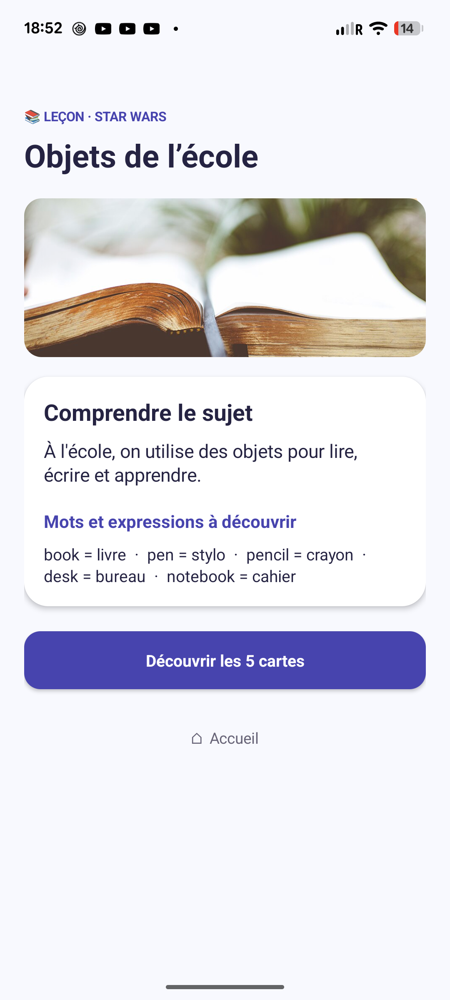
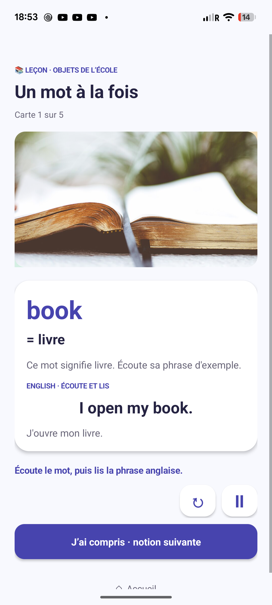
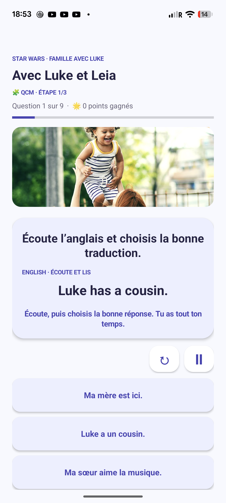

# Hello Quest

Prototype Android pour apprendre les bases de l’anglais en CE2, sur téléphone, tablette ou en écoute partagée avec Android Auto. L’enfant découvre une notion dans une **leçon**, la pratique dans des **exercices**, puis la valide avec un **quiz**. Un univers (Star Wars, Harry Potter, Échecs, Jeux vidéo, Voyages et pays, Animaux) donne un cadre familier à chaque sujet d’apprentissage.

Le catalogue contient **41 sujets**, déclinés dans **6 univers**. Les leçons présentent le principe, des mots utiles, leur traduction et des photos. Elles avancent à l’action de l’enfant. Les exercices alternent réponse orale, QCM, remise en ordre et réponse libre. Les quiz comptent 5 à 10 QCM ; un résultat supérieur à 75 % valide le couple sujet–univers. Les exercices et quiz sont accessibles uniquement après la leçon correspondante. La progression et les points sont enregistrés localement sur l’appareil.

## Captures du Pixel 7

| Accueil | Leçon : introduction |
|:---:|:---:|
|  |  |
| **Leçon : carte de vocabulaire** | **Exercice QCM** |
|  |  |

[Voir aussi le quiz sur Pixel 7](docs/screenshots/quiz-pixel-7.png). Captures prises sur l’application installée, via ADB.

## Construire et installer

Pré-requis : JDK 17, Android SDK Platform 35 et Build Tools, Python 3 et `ffmpeg`. Le wrapper Gradle télécharge Gradle au premier lancement. La génération des voix nécessite une connexion Internet ; les pistes préenregistrées occupent environ **716 Mio** et ne sont pas versionnées. Prévoir la place nécessaire pour les pistes et l’APK. Indiquer le SDK par `ANDROID_HOME` ou dans `android/local.properties` (par exemple `sdk.dir=/chemin/vers/Android/Sdk`).

Depuis la racine du dépôt :

```sh
python3 -m venv .venv
.venv/bin/python -m pip install -r tools/requirements.txt
.venv/bin/python tools/build_audio.py --jobs 8
python3 tools/validate_content.py
cd android
./gradlew :app:assembleDebug :app:lintDebug
```

L’APK debug se trouve dans `android/app/build/outputs/apk/debug/app-debug.apk`. Il est signé avec la clé de débogage locale et convient aux essais du PoC :

```sh
adb install -r android/app/build/outputs/apk/debug/app-debug.apk
```

Le minimum est Android 8.0 (API 26). Le service de reconnaissance vocale du téléphone peut nécessiter le réseau selon la configuration de l’appareil. Les voix des leçons et exercices sont préparées avant le build : français `fr-FR-DeniseNeural`, anglais britannique `en-GB-SoniaNeural` et américain `en-US-JennyNeural`, via [edge-tts](https://github.com/rany2/edge-tts). L’application ne contacte pas le service TTS pendant une séance.

**Android Auto.** L’application expose un catalogue média et des pistes audio adaptées à l’écoute en voiture. La correction orale et les QCM restent sur le téléphone. Pour tester un APK installé hors Play Store, il peut être nécessaire d’activer « Sources inconnues » dans les options développeur d’Android Auto, puis de vérifier « Personnaliser le lanceur » ; voir la [documentation Android de test sur voiture](https://developer.android.com/training/cars/testing). L’aide correspondante est dans les réglages de l’application.

## Modifier le contenu

- `content/dialogues-poc.json` : source des univers, sujets, cartes théoriques, questions et textes audio.
- `content/photo-map.json` et `content/photo-credits.json` : associations et crédits des photographies ; les fichiers image sont dans `android/app/src/main/assets/photos/`.
- `tools/build_photo_catalog.py` : génère `content/lesson-photos.json` à partir des sources précédentes.
- `tools/export_dialogues.py` : régénère `content/dialogues-poc.md` et les données de la [maquette navigateur](maquettes/index.html).
- `tools/build_audio.py` : génère les clips et pistes dans `android/app/src/main/assets/audio/`.
- `tools/validate_content.py` : vérifie les références, les traductions et la couverture du contenu.

Après une modification du catalogue ou des photos :

```sh
python3 tools/build_photo_catalog.py
python3 tools/export_dialogues.py
.venv/bin/python tools/build_audio.py --jobs 8 --rebuild-tracks
python3 tools/validate_content.py
```

Le build Gradle copie automatiquement les catalogues nécessaires depuis `content/` vers les assets Android. Ces copies, les pistes audio et les sorties de build sont exclues de Git. Les photos et leurs attributions sont conservées dans le dépôt ; leur provenance et leur licence figurent dans [photo-credits.json](content/photo-credits.json). Les univers sous marques tierces servent au PoC familial et ne constituent pas une affiliation officielle.

L’APK local `HelloQuest-Pixel7.apk` est également exclu de Git : il dépasse la [limite de 100 Mio des fichiers GitHub ordinaires](https://docs.github.com/en/repositories/working-with-files/managing-large-files/about-large-files-on-github). Pour partager un build, téléverser l’APK séparément comme [asset d’une GitHub Release](https://docs.github.com/en/repositories/releasing-projects-on-github/about-releases). Le [dossier de projet](DOSSIER_PROJET.md) retrace les choix de conception et les limites du prototype.
