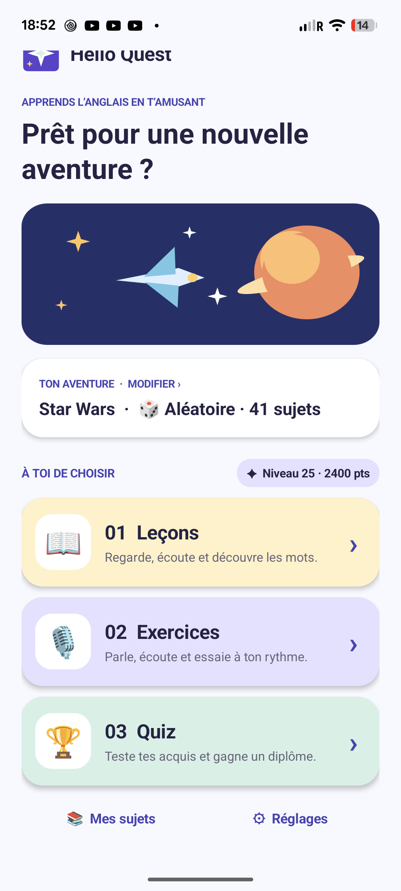
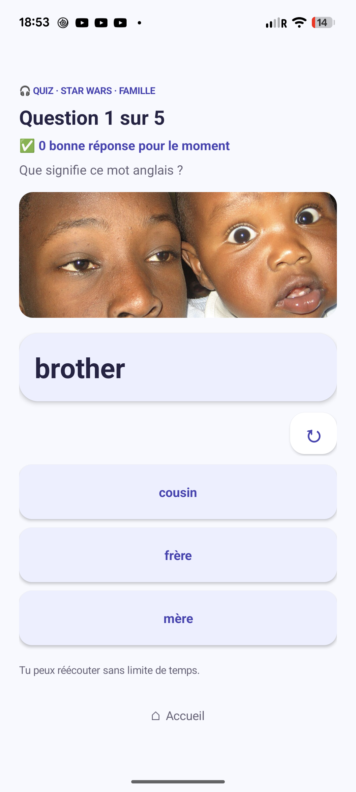

# Hello Quest

**Apprendre les bases de l’anglais à travers de courtes aventures audio.**

Hello Quest est un prototype Android destiné aux enfants francophones qui débutent l’anglais, notamment en CE2. Un parent choisit un **sujet d’apprentissage** (couleurs, pronoms, famille, verbes…) et un **univers** familier à l’enfant. Le sujet définit ce qu’on apprend ; l’univers donne un cadre à la leçon, aux exercices et au quiz. L’application fonctionne sur téléphone et tablette, sans compte à créer ; un catalogue audio distinct est disponible pour Android Auto.

Le catalogue actuel associe **41 sujets** à **6 univers** (246 combinaisons) : Star Wars, Harry Potter, Échecs, Jeux vidéo, Voyages et pays, et Animaux. Un sujet peut être étudié dans plusieurs univers, ou choisi aléatoirement pour varier les séances. Par exemple, le sujet *Couleurs* dans l’univers *Échecs* introduit des mots comme *black* et *red* dans une aventure autour de l’échiquier.

## Découvrir l’application

| Accueil | Leçon de vocabulaire |
|:---:|:---:|
|  |  |
| **Exercice** | **Quiz** |
|  |  |

[Voir aussi l’introduction d’une leçon](docs/screenshots/lecon-introduction.png).

Le parcours suit trois étapes :

1. **Leçons** — une introduction explique la notion, puis des cartes présentent les mots, leur sens, un exemple prononcé en anglais et une photographie. L’enfant passe à la carte suivante quand il est prêt.
2. **Exercices** — après la leçon correspondante, il pratique à son rythme : répéter une phrase, choisir une réponse, remettre des mots dans l’ordre ou répondre oralement. La traduction française accompagne les exercices parlés.
3. **Quiz** — après la leçon, 5 à 10 QCM vérifient la compréhension, sans répéter le cours. Il faut **plus de 75 %** de bonnes réponses pour valider le sujet dans l’univers choisi.

La page des sujets indique **Non vu**, **Vu** après une leçon terminée, puis **Validé** après un quiz réussi. La progression, les points, les badges et les univers débloqués sont conservés localement sur l’appareil. L’application propose aussi de courtes lectures guidées et des mini-dialogues. Les réglages permettent de choisir l’accent anglais, le temps de réflexion et le nombre de questions.

### Voix et usage en voiture

Les consignes françaises et les exemples anglais utilisent des voix distinctes. Les voix anglaises britannique et américaine sont sélectionnables dans les réglages. Les clips sont générés **avant** la compilation avec [edge-tts](https://github.com/rany2/edge-tts) ; aucune synthèse vocale n’est demandée pendant une séance. La reconnaissance des réponses orales est fournie par le service Android de l’appareil et peut nécessiter une connexion selon sa configuration.

Sur **Android Auto**, Hello Quest expose une source média : les leçons et questions sont lues sous forme de pistes avec des pauses pour répondre à voix haute. Cette écoute ne note pas la réponse de l’enfant. Les QCM et la reconnaissance vocale restent dans l’interface du téléphone ou de la tablette. Pour tester un APK installé hors Play Store, l’option Android Auto **Sources inconnues** peut être nécessaire ; voir la [documentation officielle de test en voiture](https://developer.android.com/training/cars/testing). Une aide est disponible dans les réglages de l’application.

## Installer ou compiler

L’application cible **Android 8.0 (API 26) ou plus récent**. Le dépôt contient les sources et les photographies, mais pas les pistes audio générées ni l’APK, trop volumineux pour le Git ordinaire. Si une version précompilée est disponible, elle se trouve dans les [Releases du projet](https://github.com/jdouliez/HelloQuest/releases). Sinon, le build debug permet de l’essayer localement.

Pré-requis pour compiler : **JDK 17**, **Android SDK Platform 36** et ses Build Tools, **Python 3.10+**, **ffmpeg/ffprobe** et une connexion Internet pour télécharger les dépendances et préparer les voix. Indiquer le chemin du SDK avec `ANDROID_HOME` ou dans `android/local.properties` (`sdk.dir=/chemin/vers/Android/Sdk`). Prévoir plusieurs gigaoctets libres : les pistes audio générées occupent à elles seules environ **716 Mio**.

Depuis la racine du dépôt, sous Linux ou macOS :

```sh
python3 -m venv .venv
.venv/bin/python -m pip install -r tools/requirements.txt
.venv/bin/python tools/build_audio.py --jobs 8
python3 tools/validate_content.py
cd android
./gradlew :app:assembleDebug :app:lintDebug
```

Sous Windows, utiliser `.venv\Scripts\python` et `gradlew.bat`. Le wrapper Gradle télécharge la version nécessaire au premier lancement. L’APK est produit dans `android/app/build/outputs/apk/debug/app-debug.apk` ; une fois revenu à la racine du dépôt, l’installer avec :

```sh
adb install -r android/app/build/outputs/apk/debug/app-debug.apk
```

Il s’agit d’un **APK de test signé avec une clé de débogage locale**. Pour installer une mise à jour sur un appareil où l’application est déjà présente, il faut conserver la [même clé de signature](https://developer.android.com/studio/publish/app-signing). Pour distribuer un APK volumineux, utiliser un asset de [GitHub Release](https://docs.github.com/en/repositories/working-with-files/managing-large-files/about-large-files-on-github), pas un fichier suivi dans Git.

Pour Google Play, les longues pistes Android Auto sont placées dans un **pack d’assets livré à l’installation** ; le module principal garde les clips des leçons et exercices interactifs. La commande `cd android && ./gradlew :app:bundleRelease :app:lintRelease` produit un AAB dans `android/app/build/outputs/bundle/release/`. Le bundle n’est signé que si `~/.config/helloquest-play/signing.properties` contient `storeFile`, `storePassword`, `keyAlias` et `keyPassword` pour une clé d’envoi privée. Ne commitez jamais cette clé ni ses mots de passe et conservez-en une sauvegarde sûre. Les éléments de fiche et la [politique de confidentialité](docs/privacy-policy.md) sont dans [`docs/play-store/`](docs/play-store/).

## Organisation du dépôt

| Chemin | Rôle |
| --- | --- |
| [`android/`](android/) | Application native Java, interface, audio et service média Android Auto. |
| [`android/audio_pack/`](android/audio_pack/) | Pack d’assets audio Android Auto livré avec l’installation Play. |
| [`content/dialogues-poc.json`](content/dialogues-poc.json) | Source des sujets, univers, leçons, exercices et textes préparés. |
| [`content/photo-map.json`](content/photo-map.json), [`content/photo-credits.json`](content/photo-credits.json) | Association des photos aux notions, sources et crédits. |
| [`tools/`](tools/) | Génération du catalogue photo, des dialogues lisibles, des voix et validation du contenu. |
| [`maquettes/`](maquettes/) | Maquettes navigateur du concept initial. |
| [`DOSSIER_PROJET.md`](DOSSIER_PROJET.md) | Historique des choix et pistes de conception. |

Après une modification du contenu, régénérer les données dérivées et les pistes Android Auto :

```sh
python3 tools/build_photo_catalog.py
python3 tools/export_dialogues.py
.venv/bin/python tools/build_audio.py --jobs 8 --rebuild-tracks
python3 tools/validate_content.py
```

Les photographies intégrées et leurs licences sont détaillées dans [photo-credits.json](content/photo-credits.json). Hello Quest est un projet indépendant, sans affiliation avec les ayants droit des univers cités. Il s’agit d’un prototype : l’expérience Android Auto est audio uniquement et la reconnaissance vocale dépend du service présent sur l’appareil.
